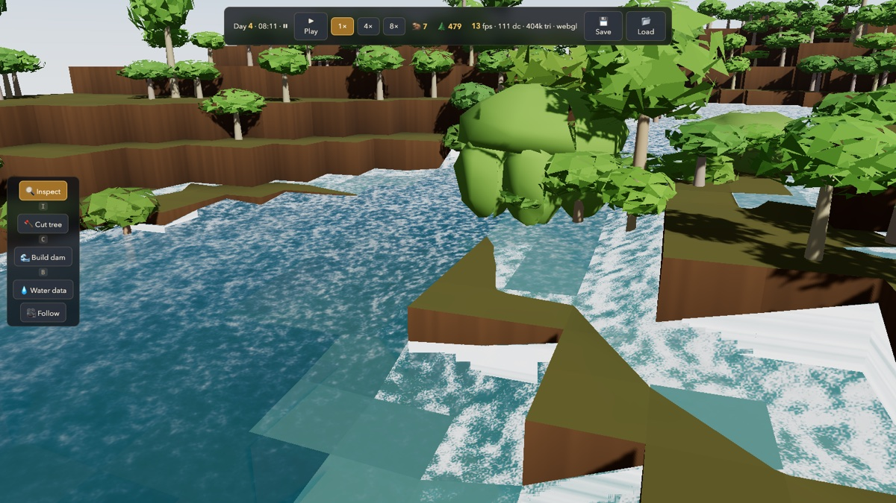

# Damn Beavers



A systemic beaver-civilization simulator: Dwarf-Fortress-class depth built from
water, materials, bodies, needs, jobs, and causality rather than scripted outcomes.

Before touching implementation, read in this order:

1. `AGENTS.md` — the non-negotiable coding constitution.
2. `DAMN_BEAVERS_MASTER_ROADMAP.md` — dependency-ordered feature list and laws.
3. `docs/ARCHITECTURE_CONTRACT.md` — layer boundaries, determinism, persistence.
4. `docs/M0_ONE_WATERSHED.md` — the current milestone's full spec.
5. `TASKS.md` — the execution ledger. Only work on unblocked tasks.

Local build manual copies:

- `docs/BUILD_MANUAL.html` — standalone local artifact manual.
- `docs/BUILD_MANUAL.md` — Markdown ledger text.
- `docs/webpage/Damn Beavers.html` — saved Claude artifact page.
- `docs/webpage/Damn Beavers_files/saved_resource.html` — actual artifact frame
  content.
- `docs/Damn Beavers.pdf` — PDF export of the artifact.

## Development

```bash
npm install
npm test          # run the test suite once
npm run test:watch
npm run typecheck
```

## Sound (the generative score, §26)

The game composes its own music from live simulation state — no samples, no
soundtrack files. Click **🔊 Sound** in the corner of the 3D client for the
built-in wood-and-water synth, or perform the score with your own instruments:

```bash
npm run osc:bridge   # WebSocket -> UDP OSC bridge (SuperCollider port by default)
npm run check:audio  # live smoke test: real game, real commands, real OSC packets
```

Then run `tools/audio/dambeavers.scd` in SuperCollider and enable **OSC bridge**
in the sound panel — or enable **MIDI out** to route the score into any DAW.
The full stream spec (OSC addresses, MIDI map, score model) lives in
`docs/AUDIO.md`.

## Repository shape

Grows incrementally per `docs/ARCHITECTURE_CONTRACT.md` — directories are created
when a feature needs them, not speculatively.

```text
src/sim/          authoritative simulation (renderer-agnostic)
tests/unit/       local invariants
tests/simulation/ headless acceptance tests for roadmap feature IDs
tools/debug/      developer inspection tooling
```
